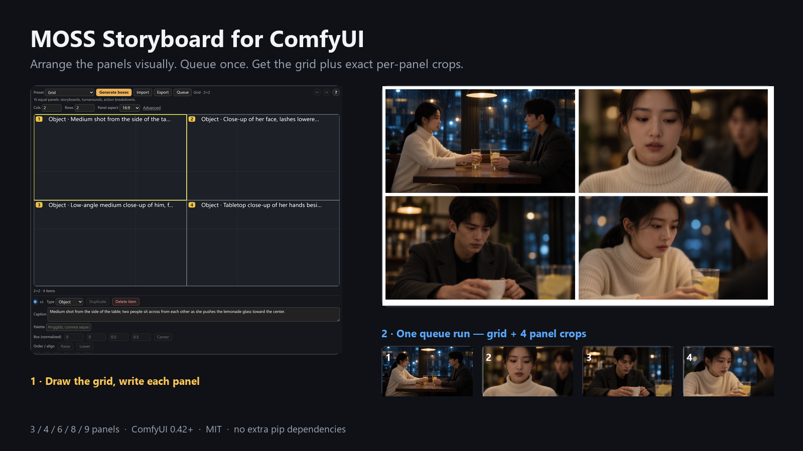

# ComfyUI-MOSS-Storyboard

🌐 **English** · [中文](README_ZH.md)



- **What it is** — layout nodes for MOSS-Image: place elements (characters / objects / text) on a canvas, get one image — a panel grid or a single poster.
- **What it does not do** — the boxes you draw are **a hint, not a bullseye**. Each box becomes one line of text in the prompt, and the model decides where things land: it can overshoot, drift, merge two boxes into one, or ignore them. See [Bounding boxes are a hint](#bounding-boxes-are-a-hint-not-a-bullseye).
- **Where to find it** — after install and restart, all six nodes sit under the **`moss/storyboard`** category.
- **First example** — [`examples/moss-layout-editor-storyboard.json`](examples/moss-layout-editor-storyboard.json): a complete 4-panel storyboard graph, open and queue.

**What this pack guarantees:** canvas size, per-panel coordinates, crop rectangles, grid-line position — arithmetic, aligned to the pixel.
**What it does not guarantee:** what ends up inside the panels, where elements land, or that the same face survives across panels. Sampling decides those.

**Two uses:** a **storyboard / comic page** — one canvas split into equal panels, one caption per panel, one crop per panel · a **poster / cover / product shot** — subject and text blocks each get a region, and text is rendered verbatim.

| Item | Value |
|---|---|
| Version | **0.2.3** |
| License | **MIT** (credits in [`THIRD-PARTY-NOTICES.md`](THIRD-PARTY-NOTICES.md)) |
| Host | **ComfyUI ≥ 0.42.0** (native MOSS-Image support landed in PR #17095) |
| Dependencies | **None** beyond host-provided `torch` / `comfy*` |

---

## Three things that prevent most misunderstandings

1. **Layout boxes are a hint, not a bullseye.** A box becomes one line of text holding coordinates, and that text goes into the prompt; the model decides where to draw. There is no mask and no regional conditioning behind a box. The next section covers what boxes can and cannot do.

2. **By default the whole board is generated in one sampling pass.** The optional `逐格` mode — that literal Chinese label is the value shown in the widget, meaning "per panel" — samples every panel on its own and then assembles the board. The default is faster, and the same face is more stable across panels. Per-panel gives each panel more pixels (more detail) and lets you rework one panel later, and it is slower — one sampling pass per panel. Panel size is set by `panel_edge` and does not shrink as you add panels: 512×288 at the factory default, 496×272 in the shipped example. What grows with the panel count is the canvas — and the VRAM that comes with it.

3. **Grid lines are redrawn after decoding (`reborder` on by default).** The lines are drawn from the same cell coordinates that the crops use, so a line and a crop edge always agree. Turn it off only if you want the model to draw the lines itself — those lines may wobble or break.

---

## Bounding boxes are a hint, not a bullseye

This is the most over-estimated part of the pack. If your requirement is "draw exactly inside the box", this pack cannot do it — and neither can any other node built on the same MOSS mechanism.

### What the model actually receives

You draw a box; the pack turns it into **one line of text with coordinates**:

```
{"caption": "a person on a bicycle", "bbox": [y0, x0, y1, x1]}
```

That line goes into `CLIPTextEncode` together with everything else, so it becomes **an ordinary text condition**:

- no mask;
- no regional conditioning;
- no separate layout channel, and nothing crops attention to those coordinates while sampling.

The official MOSS template, KJ's layout node and this pack all work this way. It is not a shortcut taken here — it is how MOSS works today.

### What that means in practice

- elements come out **larger or smaller** than the box, and **slightly off**;
- **two boxes can merge** — you place the person and the table apart, the model puts the person on the table;
- the model can **ignore the boxes entirely** and cram everything into one panel;
- **small boxes are ignored first**: small text and small objects disappear before anything else;
- the same prompt with a different seed follows the boxes differently.

### What the boxes do buy you

**They shift roughly where things go and roughly how big they are. They do not place anything precisely.**

In one controlled comparison a box was moved from outside the frame to the lower-left corner with nothing else changed: the bicycle went from "cropped out" to "fully visible, lower left", reproducible across 3 seeds (36 images; see [Known limits](#known-limits-read-before-filing-a-bug)).

That is a **directional** change — presence, side, rough size. It is not coordinate-level placement: the model does not honour where the box edge falls to the pixel.

### What they are good for

- **separating regions** in a multi-element image, which clearly reduces elements invading each other;
- making sure an element **exists** and is **roughly over there** — more reliable than prose alone;
- **in grid mode, each panel's box and its crop rectangle come from the same arithmetic.** That is *geometric* precision — crops line up to the pixel. It is not *pictorial* precision. The two are constantly confused.

### Do not use boxes for

| Not possible | Why |
|---|---|
| pinning eyes, fingers or a small prop to a spot | a box is coordinates inside text; nothing crops attention to it |
| guaranteeing a text box never overflows by a pixel | box height does not control type size — a 43 px tall box rendered ~130 px tall text in our runs (see [Text](#text-what-works-what-does-not)) |
| keeping two elements from overlapping | boxes carry no mutual constraint; the model may paint them into each other |
| keeping the same face across panels | identity is not a box problem, and this pack does not promise it (see [Not possible](#not-possible-in-this-version)) |

**For pixel-level control you need a model or a ControlNet with masks or regional conditioning — that is outside this pack.** What this pack does: write the prompt correctly, compute the canvas, cut the panels, and paste an edited panel back.

---

## What this adds over the official MOSS-Image layout

The official ComfyUI template already supports **layout boxes on one canvas**. This pack builds the repeatable multi-panel workflow around that capability.

**Let us be precise about the pitch**: this pack does **not** sell "control over composition" — as the previous section shows, boxes are hints and nobody can do better on this mechanism. What it sells is **removing the manual work**: canvas size, per-panel coordinates, crops and pasting back are arithmetic, and this pack gets that arithmetic right. What the picture contains is still up to the model.

| | Official MOSS layout | This pack |
|---|---|---|
| Single image with layout boxes / text | ✅ native | ✅ visual editor + 8 presets |
| Multi-panel storyboard in one canvas | — | ✅ 3 / 4 / 6 / 8 / 9 |
| Per-panel captions → layout boxes | draw each box by hand | ✅ `[PANEL n]` blocks |
| One crop per panel | manual crop math | ✅ `spec`-driven |
| Reusable layout state | per-node fields | ✅ v3 state + undo/redo |
| Queue from the editor | — | ✅ one click |
| External planner JSON | — | ✅ elements-v1 + CLI |
| Extra pip dependencies | — | none |

**Not a fit if** you only make single-subject images with one or two boxes — the official template is simpler. **A good fit if** you need repeatable multi-panel pages, per-panel captions, or panel crops for downstream editing.

---

## Features

| Capability | Notes |
|---|---|
| **3 / 4 / 6 / 8 / 9 panels** | Panel count is an input (`panels`); layout and canvas size are derived, then rounded up to a multiple of 16 |
| **Per-panel captions** | `[PANEL 1]`…`[PANEL n]` blocks become MOSS layout boxes |
| **Visual layout** | A canvas inside the node: drag boxes to say **roughly** which region each element occupies, then fill in its description. Boxes become coordinates in the prompt — **a hint, not a promise** (see [Bounding boxes](#bounding-boxes-are-a-hint-not-a-bullseye)). Text elements also take the literal string to render |
| **8 layout presets** | grid / split vertical / split horizontal / title + subject + body / three columns / centered subject / stacked / free (blank canvas) |
| **Text posters** | Chinese, English, mixed and two-line text have small-sample measurements (see Known limits) |
| **Deterministic grid lines** | Redrawn from the cell coordinates after decoding (`reborder` on by default) |
| **Per-panel crops** | Row-major, cut at the same integers that define the cells; `spec` carries all geometry in one wire |
| **Official prompt-enhancer bridge** | Paste a draft from OpenMOSS's MOSS-Image Prompt Enhancer skill: get a validated MOSS prompt, and for layout drafts a state v3 for the Layout Editor |
| **Bilingual UI (zh / en)** | A 中 / EN button on each of our nodes; display-only, never touches saved values |

**Six nodes, one entry point.** The shipped example wires the full storyboard path. A minimal graph needs only the Sampler, which carries every geometry parameter. The Layout Editor is the other entry point: in its **single mode** there are no `[PANEL n]` blocks — you place boxes instead, which suits posters, covers and product shots. (Its grid mode does compile `[STYLE]` + `[PANEL n]`; the table in the Layout Editor section lists both modes.) Storyboard · Grid Layout is an optional front end: preview the grid shape, or freeze the geometry into one `spec` that several downstream nodes can share. Prompt · Draft Compiler is the bridge to the official prompt skill: paste the official draft, get a MOSS prompt, and for layout drafts a second state you can import into the Layout Editor.

| Node (English / 中文) | Type | Required? | Role |
|---|---|---|---|
| 🎬 Layout Editor / 布局编辑器 | `MossLayoutEditor` | Optional (posters / free layouts) | Canvas + elements → layout prompt + sampling size. **No model loaded** |
| 🎬 Storyboard · Generate / 故事板 · 生成 | `MossStoryboardSampler` | **Yes** (storyboards) | `model + clip + vae + positive` → grid + panels. Computes geometry from its own parameters when `spec` is absent |
| 🎬 Storyboard · Grid Layout / 故事板 · 宫格几何 | `MossStoryboardLayout` | Optional (recommended) | Geometry + layout JSON + grid template. **No model loaded** |
| 🎬 Storyboard · Split Panels / 故事板 · 裁格 | `MossStoryboardCrop` | Optional | Crops only; feed `spec` to cut the panels that were generated |
| 🎬 Storyboard · Paste Panel / 故事板 · 贴回 | `MossStoryboardPaste` | Optional | Pastes a corrected panel back at the `spec` coordinates, returning the full corrected board |
| 🎬 Prompt · Draft Compiler / 提示词 · 草稿编译 | `MossPromptCompiler` | Optional (official skill bridge) | Prompt-enhancer draft → MOSS prompt + editor state. **No model loaded** |

> Node labels switch with the UI language.
> **When `spec` is connected it wins.** The Sampler's `panels` / `panel_edge` / `gutter` / `margin` widgets are still there but no longer take effect, and its `report` says so in the first line. That is the most common trap.

---

## Requirements

| Dependency | Required | Where |
|---|---|---|
| ComfyUI **≥ 0.42.0** | ✅ | older versions lack the `moss_image` text-encoder type |
| `moss_image_sft_bf16.safetensors` | ✅ | `models/unet/` or `models/diffusion_models/` |
| `qwen3.5_9b_int8_convrot.safetensors` | ✅ | `models/clip/` |
| `flux2-vae.safetensors` | ✅ | `models/vae/` |
| pip packages | ❌ | none |

Weights are **not** bundled. For download links and the exact folder names, follow the official ComfyUI MOSS-Image tutorial: <https://docs.comfy.org/tutorials/image/moss-image/moss-image>.

The optional 4-step distilled LoRA is **not** part of this pack. The shipped workflow contains a `LoraLoaderModelOnly` node **bypassed by default**. The shipped graph uses the **MOSS-Image-SFT model card settings — 50 steps / cfg 3 / euler / sgm_uniform**. Un-bypass the node (`Ctrl+B`) once you have the file, then set `steps` to **4** and `cfg` to **1.0**.

> **Host version also changes VRAM.** The fix is commit `d07dff4` (2026-10-23). As of 2026-10-24 it is **not in any tagged release** — so pip / desktop / portable builds, and `git clone`s that have not pulled since 2026-10-23, use the **Old** column. A recent `git pull` uses the **New** column. If unsure, budget for Old.
> Numbers, and how to tell which column you are in → [How much VRAM](#how-much-vram).

---

## Install

**ComfyUI Manager (recommended)**
Search for **MOSS Storyboard** → Install → restart ComfyUI.

**ComfyUI CLI** (if your install ships the `comfy` command)

```bash
comfy node install moss-storyboard
```

**git**

```bash
cd <your ComfyUI>/custom_nodes
git clone https://github.com/ZenHG/ComfyUI-MOSS-Storyboard
```

Restart ComfyUI. Six nodes appear under **`moss/storyboard`**, and the startup log shows a line like this (`<version>` is whatever you installed):

```
[MOSS SB] v<version> 已加载｜节点 6 个（出口 v3）｜3/4/6/8/9 宫格
```

> That is Chinese for "v`<version>` loaded | 6 nodes (v3 exit) | 3/4/6/8/9 grids".

**No such line = the pack did not load** — that check is more direct than any setting. To fall back to the legacy V1 node API, set the environment variable `MOSSSB_NODE_API=v1`.

---

## Quick start

**Fastest path — open the shipped graph**

1. Install the pack and the three model files above.
2. **Drag** [`examples/moss-layout-editor-storyboard.json`](examples/moss-layout-editor-storyboard.json) **into the ComfyUI window** (or `Workflow → Open`). Everything is already wired.
3. Queue. Outputs: a **1024×576** grid and four **496×272** panels.

> **Where do the images go?** This pack does not save anything itself. The shipped graph wires `SaveImage`, so files land in `output/moss/storyboard/` under your ComfyUI root — `grid_*.png` and `panel_*.png`. **With no save node attached, the image only exists in memory and is gone when the run ends**, so remember to add one when you wire your own graph.

**Text-only path — one Sampler node**

1. `UNETLoader` → `moss_image_sft_bf16.safetensors`
2. `CLIPLoader` → `qwen3.5_9b_int8_convrot.safetensors`, with **`type` set to `moss_image`**.
3. `VAELoader` → `flux2-vae.safetensors`.
4. Add 🎬 Storyboard · Generate and wire `model` / `clip` / `vae`.
5. **Set `panels` to 4.** ⚠ The factory default is **8**. The script below has **4** `[PANEL]` blocks, and a caption count that does not match the panel count **raises an error before sampling starts**. Change the count first, then queue.

   Canvas size follows automatically — never type width / height by hand.
6. Paste the script into **`positive`** on Storyboard · Generate:

```
Rainy-night cafe, one canvas divided into a strict grid of 4 panels, thin white dividers;
35mm film, real actors, natural skin texture, shallow depth of field

[PANEL 1]: medium shot, two people across a table, she pushes the lemonade glass to center
[PANEL 2]: close-up, her lashes against rain-streaked glass
[PANEL 3]: over-the-shoulder, he looks out the window
[PANEL 4]: tabletop close-up, two hands resting on the rim
```

7. Queue. Then wire the outputs — **both are images and neither is saved for you**:

| Output | What it is | Wire to |
|---|---|---|
| `grid` | the whole canvas | `SaveImage` (write to disk) or `PreviewImage` (look only) |
| `panels` | one image per panel | `SaveImage` — writes N files in one go |

A ready-made plain graph is in `examples/moss-storyboard-4panels-ui.json`.
Editor examples: `examples/moss-layout-editor-poster.json` (poster) and `examples/moss-layout-editor-storyboard.json` (4-panel storyboard).
Draft compiler (no model, no GPU): `examples/moss-prompt-compiler.json` — paste an official prompt-enhancer draft, get a prompt plus an editor state.

> To check the grid shape before spending a run, wire `spec` out of 🎬 Storyboard · Grid Layout: its `template` output is a picture of where each panel sits and how wide the gutters are.

**The other path: poster / cover / product shot**

No `[PANEL n]` blocks — place boxes instead:

1. Add 🎬 Layout Editor and pick a preset (e.g. `title-body`, shown as *title + subject + body*).
2. Drag boxes on the canvas: one for the title, one for the subject, one for the subtitle.
3. Fill each box's **caption**; text boxes also get the **literal string**.
4. Wire `prompt` → `CLIPTextEncode.text`, `width` / `height` → `EmptyFlux2LatentImage`.
5. Follow with a plain `KSampler` — MOSS-Image-SFT model card settings are 50 steps / cfg 3 / euler.

> ⚠ **Single mode's `prompt` is already layout JSON — do not feed it to the storyboard Sampler.** The Sampler would re-parse it as `[PANEL n]` blocks and get it wrong. Use a plain `KSampler`.
>
> (Related but different: if you skip the editor and just want one non-grid image, set `panels = 1` on the Sampler. That path sends prompt text, not JSON, so the warning above does not apply.)

---

## When something goes wrong

**Match the error text first.** Every row below is copied verbatim from a `ValueError` in the source. Note that **the error messages themselves are in Chinese** — paste a few characters into a search here to find your row.

| Error text (Chinese, verbatim) | What it means | Fix |
|---|---|---|
| `提示词有 4 段 [PANEL]，但布局是 8 格` | the script has a different number of blocks than there are panels | add blocks to match, set `panels` to the block count, or switch `init` to `plain` |
| `全局段写「恰好 4 个面板」，但布局是 8 格` | the count written inside the global section disagrees with the real panel count | change that number to the real count, or delete the phrase |
| `图像 1024x576 不能被 3x3 整除` | the crop node has no `spec`, so it can only divide by columns × rows | connect `spec` (recommended), or use a canvas that divides evenly |
| `draft 为空：请粘贴官方 prompt-enhancer 的 caption/layout 草稿 JSON。` | the Draft Compiler received nothing | paste the **draft**, not the compiler's own output |
| `元素 3 没有描述（caption 不能为空）` | a box on the canvas has an empty caption | give it a caption, or delete the box |
| `label 只能是 object/character/text（收到 'xxx'）` | a hand-edited state or draft used another type | only those three values are allowed |

**No error, but the result is wrong:**

| Symptom | Check first |
|---|---|
| All black | mismatched recipe: a 4-step distilled LoRA with 50 steps / cfg 3, or no LoRA with 4 steps / cfg 1.0 |
| Right panel count, everything crammed into one panel | the model ignored the boxes (see [Bounding boxes](#bounding-boxes-are-a-hint-not-a-bullseye)); shorten each caption to one shot |
| Canvas shape differs from the preview | is `spec` connected? When it is, the Sampler's panel-count widgets are ignored |
| Can't find the nodes | category `moss/storyboard`; searching `故事板`, `storyboard` or `宫格` also works |

The rest of the Q&A (OOM, the 中 / EN button, negative prompts) is in [FAQ](#faq) at the end.

---

## Prompt rules (three, no more)

1. Everything **before the first `[PANEL …]`** is the **global description** (character look, scene, style, camera). Writing `[STYLE]:` is optional — it is only a readable label; the parser goes by position.
2. Each `[PANEL n]` block describes **that panel**: shot size + subject + action.
3. **Panel numbers are an ordering key, not a cell slot.** Captions are sorted by number and paired with cells in that order: the first caption goes to the first cell, the second to the second, and so on. Gaps and out-of-order blocks are accepted; the numbers do not pick a cell (a lone `[PANEL 6]` still lands in cell 1).

**The block count must equal the panel count.** In whole-canvas mode the node compares the two and refuses to run when they differ. The error states both numbers and offers the way out.

| You write | Result |
|---|---|
| `[PANEL 1]: …` `[PANEL 2]: …` with `panels = 2` | Two captions → panels 1 and 2 |
| `[画面 1]: …` `[分镜 1]: …` | Also valid (Chinese markers are recognised) |
| No `[PANEL]` at all, `init = plain` | The whole text is a plain prompt; **no layout boxes** are compiled (`report` says so). The canvas is still the grid canvas — see the note in the FAQ |
| 4 panels and 4 captions | Normal case |
| 8 panels but only 4 captions | **Error.** Add four more blocks, set `panels = 4`, or switch `init` to `plain` |
| One caption spread over several lines | Merged into a single caption; no effect |

**Two rules of thumb**

- If a character drifts between panels, **fix the global description first** — it carries the most weight.
- One shot per panel. A compound caption such as "medium shot + close-up" makes the model pick one.

---

## Panels → canvas

`canvas = panel size × count + gutters + margins`, then **rounded up to the next multiple of 16**. The extra 0–15 px goes **only into the right and bottom margin** (same colour as the grid lines, so it is invisible). Panel sizes are never touched — otherwise every panel coordinate would drift.

**Why 16 matters**: MOSS's VAE downscales by 16, so a width or height that is not a multiple of 16 misaligns. The node aligns everything for you.

Numbers below: panel 16:9, long edge 496, gutter 8, margin 8 — the shipped workflow's settings (4 panels come out 1024 wide, hence "the 1024 tier"). **The factory default is 512**, two notches larger, with a correspondingly larger canvas. Any table using one of the two says which.

| Panels | Shape | Canvas | MP | Panel size |
|---|---|---|---|---|
| 3 | **vertical strip** (3 stacked) | 512 × 848 | 0.43 | 496 × 272 |
| 4 | **quad** (2 × 2) | **1024 × 576** | 0.59 | 496 × 272 |
| 6 | **wide** (2 rows of 3) | 1520 × 576 | 0.88 | 496 × 272 |
| 8 | **wide** (2 rows of 4) | 2032 × 576 | 1.17 | 496 × 272 |
| 9 | **3 × 3** | 1520 × 848 | 1.29 | 496 × 272 |

Panel size does not change between 3 and 9 panels. Only the canvas grows. `panels` also accepts any count from 1 to 12; other counts are factored into `columns × rows` automatically.

8 and 9 panels land in MOSS's 1–2 MP training range; 3 / 4 / 6 are below it — usable, but outside the range the model was trained on. Portrait panels (`panel_aspect = 9:16`) rotate the whole layout by 90°: 3 panels become a horizontal strip (848 × 512), 6 become 2 × 3 (576 × 1520), 8 become 2 × 4 (576 × 2032); 4 and 9 are unchanged.

| Knob | Widget | What it does |
|---|---|---|
| Bigger panels | **panel long edge** (`panel_edge`) | 128–2048, step 16. The canvas follows. `panel_aspect` accepts 10 ratios: `16:9` `3:2` `4:3` `1:1` `4:5` `3:4` `2:3` `9:16` `21:9` `2.39:1` |
| Force a layout | **columns** (`columns`) | Set the column count and leave `rows = 0` to fill it in. `columns × rows` must equal the panel count |
| Three panels in a row | **columns** = 3 | Three 16:9 panels in a row would make a 1520 × 288 canvas (≈5.3:1), past this pack's 4:1 tolerance — so 3 panels default to a vertical strip |

---

## How much VRAM

VAE decode — not sampling — is the memory peak. The same canvas can differ by up to **4×** depending on your host version (the old build reserved 4× what it actually needs).

| Canvas | Panels | New host | Old host |
|---|---|---|---|
| 1024 × 576 | 4 | ~0.6 GB | ~2.4 GB |
| 2032 × 576 | 8 | ~1.2 GB | ~4.8 GB |
| 1520 × 848 | 9 | ~1.3 GB | ~5.2 GB |
| 2096 × 608 | 8 (factory 512 px edge) | ~1.3 GB | ~5.2 GB |

The first three rows use the shipped workflow's 496 px panel edge; the last row is the factory 512 px default.

**Which column are you in?** The fix is commit `d07dff4` (2026-10-23). Check whether your host build contains it; if unsure, use the **Old** column.

| How you installed | Column |
|---|---|
| Desktop / portable / pip | Depends on the build; if unsure, **Old** |
| `git clone` + `git pull` after 2026-10-23 | **New** |
| `git clone` but not pulled recently | **Old** |

**Measured tiers on a single 12 GB card, whole-canvas mode** (50 steps / cfg 3.0 / euler + sgm_uniform / 16:9). ⚠ This set ran **with the 4-step distil LoRA attached**, so it is not the same operating point as the 50/3 rows elsewhere — use it for headroom, not for quality.

⚠ **The raw data only records peak VRAM and whether the run OOMed** (all six runs: `success`). **Nobody graded the images.** "It fit" does not mean "the picture was right", and this combination — 4-step LoRA with 50 steps — is one of the mismatched recipes the FAQ lists as a common cause of black output. Do not read this table as a recommended recipe.

| panels × `panel_edge` | canvas | MP | peak MB |
|---|---|---|---|
| 4 × 512 | 1056×608 | 0.64 | 11359 |
| 4 × 544 | 1120×640 | 0.72 | 11176 |
| 6 × 512 | 1568×608 | 0.95 | 11250 |
| 6 × 544 | 1664×640 | 1.07 | 11267 |
| 8 × 512 | 2096×608 | 1.27 | 11269 |
| 8 × 544 | 2224×640 | 1.42 | 11298 |

> Numbers only — this pack publishes no speed numbers (timing depends on your machine and goes stale). Across 0.64–1.42 MP the peak sits at 11.2–11.4 GB: **≈0.9 GB of headroom for the whole canvas**. The worst point measured anywhere — per-panel, 8 × 544 — leaves **0.7–0.8 GB**. So a 12 GB card runs these tiers, **but it can still OOM when the desktop is already holding VRAM**. Do not read this as "12 GB is enough".
> Data [`docs/data/g1-results.json`](docs/data/g1-results.json); per-run log and caveats [`docs/data/g1-report.md`](docs/data/g1-report.md).

**When memory runs short**, the host tries the full-image decode first, then falls back to **tiled decode**. A tile border may fall inside a panel, and a seam can appear there. Look for `retrying with tiled VAE decoding` in the log. Whether a seam actually cuts a panel is mechanism, not measured here.

**Fixes, cheapest first**: ① `git pull` the host; ② lower `panel_edge` (half the edge → ¼ the decode memory); ③ use fewer panels (8 → 4 halves the canvas area).

> ⚠ The saving only applies when the VAE runs in fp16 or bf16. `--fp32-vae`, or a host that falls back to fp32, silently disables it.

---

## Bilingual UI

Each of **our** nodes has a **中 / EN** button switching titles, labels, combo display and tooltips. The default follows the host locale.

- **Only our nodes** are touched — never official or third-party nodes.
- **Display only, never the graph**: only `label` / `title` / `tooltip` / `placeholder` change; widget `name`s and values never do, so execution and saved values are unaffected.
- **Hard-refresh the browser (F5) after upgrading** — restarting the ComfyUI process is not enough.
- **It works without the frontend too**: the backend's default readable strings are Chinese. If the JS fails to load you lose the 中 / EN switch and the editor, but the nodes still run on their defaults. API submissions (`/prompt`) never needed the button.

---

## Node reference

### 🎬 Layout Editor (`MossLayoutEditor`, no model)

**Start here for posters, covers, product shots, or any free-form layout.**

The node is a canvas: place boxes on the left, fill in descriptions on the right. **A box is a hint, not a bullseye.** Boxes are compiled into layout JSON and handed to the model as text through `CLIPTextEncode` — there is no `area`, no mask and no conditioning channel behind them. A box steers roughly where an element appears; it cannot pin it there. The model can overshoot, drift or ignore it entirely (see [Bounding boxes](#bounding-boxes-are-a-hint-not-a-bullseye)).

Outputs (7): `prompt` `width` `height` `spec` `template` `report` `negative`

- **`negative`** — non-empty only in **single mode with *Blend into one* on**: a few anti-collage words the pack supplies for you. Empty in grid mode, and empty in single mode with blending off. Wire it into a negative input, or ignore it.
- In single mode `spec` is an empty string (there is no grid to cut) and `template` is a flat placeholder image. In grid mode both are usable, and `spec` can feed Crop and Paste.

| Input | Notes |
|---|---|
| `editor_state` | **Do not type here.** This is the canvas save file and it updates itself. Hand-editing works, but it must be valid v3 JSON; a bad field is rejected and the error names the field |
| `prompt` | Optional, wired. Takes over the **text** only: the global description plus each panel's caption and shot size. See below |

**What happens when you wire an external prompt**

- Panels covered by the wired script lose the editor caption (including preset copy), and the caption field becomes read-only. Unplug to edit by hand again.
- Fewer segments than panels: the remaining panels keep the editor caption. More segments than panels: the extras are dropped. No `[PANEL n]` at all: only the global description changes.
- A segment with no shot size does not inject one for that panel.
- **Canvas, panel count and panel coordinates always come from the editor.** The wired script cannot change geometry.
- Single mode has no panels, so the wired script only takes the global description.

The **Final prompt** box shows the **merged** result — exactly what gets sent. If the upstream node computes its text at runtime, the box says so instead of pretending the editor content is final.

Two modes, switched by preset:

| Mode | Presets | Output | Wire to |
|---|---|---|---|
| **Single** | split vertical / split horizontal / title + subject + body / three columns / centered subject / stacked / free | One multi-element layout JSON, **one sampling pass** | `CLIPTextEncode.text`, then a plain `KSampler` |
| **Grid** | `grid` | `[STYLE]` + `[PANEL n]` | the Sampler's `positive` + `spec`; default `整张` (whole canvas), switch to `逐格` (per panel) when you want to rework panels one by one or need more pixels per panel |

> In single mode the `prompt` output is **already layout JSON** — feed it straight to `CLIPTextEncode`. Do **not** chain the storyboard Sampler there; it would parse the JSON as caption blocks again.

**Blend into one** is a checkbox above the canvas and **exists only in single mode**. It joins neighbouring boxes at their mid-line, snaps boxes near the canvas edge, adds a "one continuous image" clause to the prompt, and fills the `negative` output. Grid mode has no such switch, and its `negative` is always empty.

**Canvas controls**

| Action | Result |
|---|---|
| Drag on empty space | Draw a new box (a new element) |
| Drag a box / its corners | Move / resize |
| Click a box | Edit type (object / character / text), description, coordinates on the right. In grid mode only **shot size + caption** are shown — type, text and palette are not compiled into a grid prompt |
| Grid shot-size dropdown | The eight tiers are **presets**; pick Custom… to write your own framing, or Unspecified to send the caption alone. **The UI shows Chinese labels, but the prompt emits an English framing clause** (MOSS is trained mostly on English) |
| Final prompt box (below the canvas) | Paste an external storyboard script and hit **Apply** to parse `[PANEL n]` back into panels; **Revert** restores the compiled text. The wheel scrolls the text instead of zooming the graph |
| Drag near another box's edge, the canvas centre line, or the rule-of-thirds lines | Snaps |
| `Delete` / arrow keys / `Ctrl+D` | Delete / nudge / duplicate |
| `Ctrl+Z` / `Ctrl+Shift+Z` (or `Ctrl+Y`) | Undo / redo (same as the `↶` `↷` toolbar buttons) |
| Import / Export | Import elements-v1 (0–1000 bbox) or state v3 JSON; export elements-v1 (a grid cannot be exported) |
| Raise / Lower + 6-way align | Change stacking (array order = z) or align to canvas edges / centre; size is kept |
| Queue | Queue the current workflow; changes no values |

> An external planner's element JSON imports directly as editable items. The CLI validator / converter is in [`docs/12`](https://github.com/ZenHG/ComfyUI-MOSS-Storyboard/blob/main/docs/12-interop.md) and does not need ComfyUI.

**A final-prompt strip sits under the canvas** (between the status line and the property panel, no scrolling needed). It shows the text handed to the model for the current state: `[STYLE]` + `[PANEL n]` per panel in grid mode, native layout JSON in single mode. Read-only, copyable, and it updates as you edit. It is compiled with the same rules as the backend (a differential test compares them), so it is not a paraphrase.

**Preset placeholders get flagged.** If you queue without editing preset copy such as `标题文字` ("Title") or `第 3 格画面` ("Panel 3"), the text fields get rendered letter by letter and the panels come out alike. The status bar counts them, the Queue button asks once, and the node's `report` says the same thing for API-only users.

**Text elements have two separate fields — do not mix them**

| Field | What goes in | Example |
|---|---|---|
| **caption** | what the text **looks like** | bold sans-serif title, pale gold, slight outline |
| **text** | the **literal characters to render** | LEGEND |

Swap them and the model will try to draw the words "bold pale gold". Only `text` is rendered verbatim.

> ⚠ **Keep text boxes away from the canvas edge.** Measured: with the box top at 5% of the canvas height, the glyphs overflow upward and get clipped. Presets use 10%, but that is only a more conservative start than 5% — **10% is not verified as safe**.

---

### 🎬 Prompt · Draft Compiler (`MossPromptCompiler`, no model)

Bridges OpenMOSS's [MOSS-Image Prompt Enhancer skill](https://github.com/OpenMOSS/MOSS-Image/tree/main/skills/moss-image-prompt-enhancer) to this pack. Paste the skill's **draft** (not its compiled output) and get:

- **`prompt`** (output 1) — a ready-to-paste MOSS prompt (plain caption, or one-line native layout JSON). Wire it into `CLIPTextEncode.text` or the Sampler's `positive`.
- **`report`** (output 2) — type, canvas, item counts, and any field that could not be represented in state.
- **`state`** (output 3) — for layout drafts, a state v3 JSON you can paste into the Layout Editor import box. The canvas must be 64–4096 px; larger or smaller drafts still compile to `prompt`, and `report` explains why `state` was skipped.

`report` is the **second** socket and `state` the **third** — sockets are wired by position, so check the order before you drag.

Draft requirements (the official schema): `width` / `height` positive multiples of 16; `bbox_coord_space="abs"`; `bbox_format="xyxy"`; `summary.caption` and a non-empty `items` array. Each item is `object` / `character` / `text`; text items must carry the literal `text`. Unknown fields, duplicate keys, NaN/Infinity and out-of-bounds boxes are rejected. The pack adds a **256-item** cap and a 1 MB draft cap.

The skill itself is external Apache-2.0 content and is **not bundled**; the compiler is an independent implementation of the documented schema. Details, limits and the offline confidence check: [prompt-enhancer doc](https://github.com/ZenHG/ComfyUI-MOSS-Storyboard/blob/main/docs/13-prompt-enhancer.md).

---

### 🎬 Storyboard · Grid Layout (`MossStoryboardLayout`, no model)

Outputs nine: `width` `height` `columns` `rows` `spec` `layout_json` `template` `report` `elements`.

- **`width` / `height`** (INT) — canvas size. Wire to `EmptyFlux2LatentImage`.
- **`columns` / `rows`** (INT) — the layout actually used. Wire them into Split Panels / Paste and those nodes do not need `spec`.
- **`template`** (IMAGE) — a picture of the grid (flat colours + gutters) for eyeballing where the panels sit. **Never enters the sampler.**

| Input | Notes |
|---|---|
| Panel count `panels` | 1–12; 3 / 4 / 6 / 8 / 9 are the usual ones, other values are factored automatically |
| Panel aspect `panel_aspect` | 10 ratios: `16:9` `3:2` `4:3` `1:1` `4:5` `3:4` `2:3` `9:16` `21:9` `2.39:1` |
| Panel long edge `panel_edge` | long edge of one panel in pixels, default 512 |
| Gutter `gutter` / margin `margin` | grid-line width / distance from the canvas edge to the first panel |
| Prompt `prompt` | **Leaving it empty is correct**: this node only computes geometry. If you do fill it, the text only feeds `layout_json` and `elements` |

- **`spec`** — one string carrying all geometry. Feed it downstream and nothing can drift.
- **`layout_json`** — same format as the host's native `MOSS-Image Layout Prompt` (`summary` + `items`; bboxes are absolute pixels measured from the canvas centre).
- **`elements`** — the canvas **element** format (`{type, desc, bbox}`, bbox **normalized to 0–1000**, `[y0, x0, y1, x1]`). Feed it to the `bboxes` input of the host's `Create Bounding Boxes` to see the cells and edit each cell's description there. `bboxes` is a MultiType input — this string is one of the three kinds it accepts.

  Wire **all three** lines. Missing one silently corrupts every box:

  ```
  width    → Create Bounding Boxes · width
  height   → Create Bounding Boxes · height
  elements → Create Bounding Boxes · bboxes
  ```

  Why: the bbox is normalized 0–1000, and the canvas node needs `width` / `height` to convert it to pixels. That canvas defaults to 1024×1024; an 8-panel strip is 2032×576, so leaving them unwired misplaces every box without any error.

  Coordinates are rounded to 0–1000 integers on the way back, so a box need not land on the same pixel. The tests assert the format, not pixel equality.

  ⚠ **`elements` is a one-way output.** It is there so you can look at the cells and edit descriptions in the host node. **Nothing you change there comes back into this pack** — the Sampler has no `elements` input. Sampling geometry comes from `spec` and the `[PANEL n]` blocks.

  ⚠ **The two formats are not interchangeable.** `elements` is canvas elements (normalized 0–1000); `layout_json` is the full layout JSON (`summary` + `items`, absolute pixels).

  ⚠ **The grid's `elements` output only describes panel slots**: one `{"type":"obj"}` item per cell, with that cell's caption as `desc`. It carries no text elements, font size or colour. For in-image text use the editor's text elements or the host `MOSSImageLayoutPrompt` path.

- **`report`** — human-readable summary (panels, canvas, MP, caption alignment, warnings).

### 🎬 Storyboard · Generate (`MossStoryboardSampler`)

Outputs `grid` `panels` `latent` `spec` `prompt_used` `report` `prompts_json` — **seven**.

- **`prompt_used`** — the **script you typed**, passed straight through. It is **not** what the model saw: the per-panel text actually sent lives in `prompts_json`. Use `prompt_used` to check "what did I write", `prompts_json` to check "what did the model read".
- **`latent`** — whole-canvas mode: the full-canvas latent; per-panel mode: a batch of N single-panel latents (`{"samples": [N,C,h,w]}`, row-major = panels 1..N, **not** a spatial stitch). Wire it to `VAEDecode` to decode the batch panel by panel.
- **`prompts_json`** — the text handed to the model, as a JSON array: one entry in `整张` mode, one entry per panel in `逐格` mode (global paragraph included, multi-panel wording stripped). Wire it to a text file if you want to audit prompts later.

Factory defaults below. The shipped workflow uses **4 panels / panel edge 496** and ships at the **MOSS-Image-SFT model card settings — 50 steps / cfg 3 / euler / sgm_uniform**.

| Parameter | Factory default | Notes |
|---|---|---|
| Positive prompt `positive` | empty | See prompt rules above |
| Generation mode `mode` | `整张` | `整张` (whole canvas) = one sampling pass for the whole board; `逐格` (per panel) = sample every panel on its own and assemble. See below |
| Panel count `panels` | 8 | used when `spec` is absent |
| Panel aspect `panel_aspect` | `16:9` | used when `spec` is absent (10 ratios) |
| Panel long edge `panel_edge` | 512 | used when `spec` is absent |
| Canvas aspect `canvas_aspect` | `auto` | used when `spec` is absent |
| Gutter `gutter` / margin `margin` | 8 / 8 | used when `spec` is absent |
| Steps `steps` | 50 | MOSS-Image-SFT model card value (the Base card gives the same 50). Set **4–8 only** with the 4-step distilled LoRA. Mixing bands does not raise an error, but results degrade (sometimes fully black) — see Known limits and the FAQ |
| CFG `cfg` | 3.0 | MOSS-Image-SFT model card value (official Base range: 3–6). Only **exactly 1.0** disables the negative prompt |
| Sampler / scheduler | `euler` / `sgm_uniform` | `euler` is the model card sampler; `sgm_uniform` comes from the official OpenMOSS ComfyUI plugin workflow (the model card does not specify a scheduler). **The scheduler list is read from the host** (`comfy.samplers.SCHEDULER_NAMES`), so new host schedulers appear automatically |
| Init mode `init` | `auto` | see below |
| Denoise `denoise` | 1.0 | Keep 1.0. The sampler has **no image input**: below 1 references no image, it only makes the host truncate sigma by `int(steps/denoise)` (equivalent to fewer steps); `report` prints nominal vs. effective |
| Redraw grid lines `reborder` | on | redraw grid lines after decode |
| Sample edge `sample_edge` | 1024 | per-panel mode only, see below |
| Negative prompt `negative` | empty | in the **Advanced** fold, optional. At **exactly `cfg = 1.0`** the host skips the negative branch entirely; any other value, including 1.01, evaluates it |
| Random seed `seed` | 0 | 0–4294967295. **The same seed plus the same settings is the only way to reproduce an image.** Changing it changes the composition — and how closely the boxes are followed |

> Why `negative` is folded away: it is an **optional** input that defaults to empty. The model card's `cfg = 3` is above 1, so anything you type does reach the negative branch. Folding it under **Advanced** only stops it from looking required.

**`mode` (how the panels are produced)**

> ⚠ **Two similar terms, opposite meanings.** **Single mode** = the Layout Editor's one-image, no-panel layout (posters, covers). **`整张`** = this node's whole-canvas option: one canvas split into N panels, generated in one pass. The table below is about the latter.

| Option | What it does | Pick it when |
|---|---|---|
| `整张` (whole canvas) | **Default.** One sampling pass for the whole board: faster, and the same face is more stable across panels | You want the board in one go, or many panels (8/9) |
| `逐格` (per panel) | Every panel is **sampled on its own**, then assembled by coordinates — one sampling pass per panel, so it is slower | You need to **rework one panel** later, or want more pixels per panel |

**The same face: measured.** ArcFace cosine over three pairs of the same woman — whole canvas `0.553` **>** per panel `0.479` (one scene, one seed; the same ruler, so only the relative order means anything here). 35% of the positive pairs had no detectable face, so **we report the number, we do not use it as a pass/fail gate, and we set no threshold.** Absolute cut-offs do not transfer between domains: images this model produces of *different* East Asian women already score around `0.52`, so the usual "above 0.5 means the same person" rule is wrong in both directions here. This page therefore gives relative only, never a pass mark.

**Per-panel detail: structural.** In `逐格` each panel is sampled at `sample_edge`, which can be larger than the final cell, then downscaled into it. That is the mechanism behind the extra detail — mechanism, not measured, and this pack publishes no sharpness numbers.

**We promise no cross-panel consistency.** Our own whole-canvas vs per-panel metrics (prop-share variance, tone spread, inter-panel difference) change direction between the human and the animal scene, so we name no winner from them. The certain gain of per-panel is that **you can redo a single panel without re-running the board**.

> Mechanism, not measured: in one pass the model spreads the global description over N regions and may settle on one face; per panel each pass re-reads the whole description and rolls the face again. That is the likely reason for the ArcFace gap, not a measured cause.

> Also: **for whole-canvas mode the global caption must declare the grid** — see [`docs/15`](https://github.com/ZenHG/ComfyUI-MOSS-Storyboard/blob/main/docs/15-recipe-contract.md).

**`sample_edge` (sampling long edge)**

The advantage of per-panel mode: a panel's **sampled** resolution is not bound by the board size. `1024` samples each panel at a 1024-pixel long edge and downscales it into its final cell. It is an **absolute pixel count**, not a multiplier — matching the host's `Empty Flux 2 Latent`, and keeping the quality knob independent of the layout knob.

> One local scan, 4 panels / 16:9: `496` came out soft, `992` sharper, `1984` looser (composition drifts apart). The scan did not include `1024`, and the sample size is not recorded. So the factory `1024` is a starting point, not a measured optimum — [`docs/07`](https://github.com/ZenHG/ComfyUI-MOSS-Storyboard/blob/main/docs/07-consistency.md) records "1024–1408 sharp but tone drifts".

VRAM scales with the pixel count. Ignored in whole-canvas mode.

> ⚠ **Per-panel resolution is where quality usually breaks first.** MOSS trains at 1–2 MP, while a 1:1 nine-panel board gives each panel only **0.26 MP** — the canvas looks fine, every panel is visibly soft. The node's `report` prints both numbers. With many panels and a near-square ratio, try `逐格`.
> In `逐格` that warning reads the **per-panel sampling canvas** (`sample_edge`) instead of the final cell size — the assembled grid is never fed to the model.

`init` values: `auto` / `layout` = panel captions become layout boxes (default); `plain` = no layout boxes. In **whole-canvas** mode that is the raw full prompt; in **per-panel** mode each cell gets the global caption (multi-panel wording stripped) plus that cell's caption — not the raw full prompt, so cross-panel anchors survive.

> **No img2img in this pack.** The latent always starts empty; keep `denoise` at 1.0. Template-latent initialisation was measured and does not work: 35 steps / denoise 0.85 → fully black; 12 steps / 0.6 and 4 steps / 0.5 → template ghosting. The template image is only an `IMAGE` output of `MossStoryboardLayout` for eyeballing the grid geometry — it never enters the sampler.
> To rework an **existing** image, see **🎬 Storyboard · Paste Panel** below — that path works, and it does not require re-running the whole board.

### 🎬 Storyboard · Split Panels (`MossStoryboardCrop`)

**Inputs** — only `image` must be connected; everything else can stay at its default:

| Input | Default | Notes |
|---|---|---|
| `image` | — | **required.** the full board (`KSampler → VAEDecode`) |
| `spec` | empty | from Generate or Grid Layout ⇒ crops land exactly where the board was generated. **Without it you must fill `columns` / `rows`** |
| `columns` / `rows` | 0 / 0 | **required when there is no `spec`**; leaving them at 0 raises instead of guessing |
| `index` | -1 | `-1` outputs every panel; a 0-based number outputs that one panel and emits the number on the `index` output |
| `shave` | 0 | pixels trimmed from each side of a panel, to eat an overflowing gutter. If you change it, use the same value in Paste |
| `resize_edge` | 0 | `0` keeps the original size (recommended); `>0` scales each panel's long edge to that value |
| `target_aspect` | `keep` | keeps the panel's own ratio (no resampling); a specific ratio centre-crops |
| `padding_mode` | `crop` | `crop` trims the excess; `pad` adds black bars (loses nothing) |
| `show_guides` | off | advanced. draws red crop lines on `preview` for eyeballing |

**Outputs** `panels` (per-panel images), `preview` (the full canvas as-is), `report`, `index` (the panel number).

With `spec` → no resampling: the crop uses the same integers that generated the board. Without `spec` → `columns × rows` must divide the image evenly, and the node **raises** otherwise.

`index` left at -1 (the default) outputs every panel. A 0-based panel number outputs just that one and emits it on the `index` output — wire that into Paste and you never type a panel number by hand.

### 🎬 Storyboard · Paste Panel (`MossStoryboardPaste`)

**Inputs**

| Input | Default | Notes |
|---|---|---|
| `grid` | — | **required.** the full board (Generate's `grid`, or the previous Paste's output) |
| `panel` | — | **required.** the corrected panel (a single image). Feeding Split Panels' one-panel output is the safest |
| `index` | 0 | which panel to write, **0-based, row-major**. Wiring Split Panels' `index` output overrides it, so they cannot disagree |
| `shave` | 0 | **must match the value used when cropping** — see below |
| `spec` | empty | exact placement needs it; without it, fill `columns` / `rows` |
| `columns` / `rows` | 0 / 0 | required when there is no `spec` |
| `show_guides` | off | advanced. frames the pasted region in pure red on `marked` |

**Outputs** `grid` (the corrected board), `marked` (debug), `report`.

**Purpose: fix one panel without re-running the whole board.** Re-running moves the seed of every panel at once. Instead: cut the panel out, correct it however you like, then paste it back at the `spec` coordinates.

- `index` is 0-based, row-major (left to right, top to bottom). Wiring Crop's `index` output overrides the widget, so it cannot disagree with the panel you actually cut.
- Only the target panel's content area is touched: gutters, margins and every other panel stay identical, and the grid lines are preserved.
- `shave` must match what you used on Crop. Both nodes inset each cell by `shave`; a mismatch makes the incoming panel size differ from the target rectangle, so it is **bicubically resampled** (scaled, with a different border) — not shifted by s pixels. `report` states the resample explicitly; check it.
- For a round trip with no resampling, use Crop with `resize_edge=0`, `target_aspect=keep`, and the same `shave`.
- To fix several panels, chain Paste nodes: the first `grid` output feeds the next `grid` input.

> Ready-made graph: `examples/moss-storyboard-4panels-edit.json` (needs the `Moss-Image-Edit` LoRA / edit node; the node contains instructions).

Recommended wiring (no manual panel numbers anywhere):

```
Crop (index set) ──panel──→ your edit chain ──→ Paste
Crop ──index──────────────────────────────────→ Paste
Sampler ──grid────────────────────────────────→ Paste
Sampler ──spec────────────────────────────────→ Paste / Crop
```

#### How to build "your edit chain" (optional — this pack needs no LoRA at all)

This pack only does geometry: cut a panel out, paste it back. **What you edit with is up to you** — any node pack you already like, external retouching, or even hand-editing the file and reloading it.

If you want MOSS's own instruction editing, the host's official nodes are enough — no third-party node pack required:

```
Crop (index) ──→ Text Encode MOSS-Image Edit ──→ KSampler ──→ VAEDecode ──→ Paste
                     ↑ needs the LoRA below
```

Steps:

1. Download the community edit LoRA **Moss-Image-Edit** (~285 MB, bf16, rank 64) — either source, same files:
   - Hugging Face: <https://huggingface.co/chinoll/Moss-Image-Edit>
   - ModelScope: <https://www.modelscope.cn/models/ChenkinLab/Moss-Image-Edit>
2. Put `adapter_model.safetensors` and `adapter_config.json` into **`models/loras/Moss-Image-Edit/`** (create the subdirectory, both files together).
3. Use the host's **`Text Encode MOSS-Image Edit`** node:
   - `clip` → your CLIPLoader (`type=moss_image`)
   - `images` → the panel you cut out
   - `edit_format` → `Moss-Image-Edit`
   - **`vae` may be left unwired**: then the reference only reaches the text encoder, which costs less VRAM. Wiring it adds reference latents, which costs more memory.
4. Follow it with a plain `KSampler` → `VAEDecode` → this pack's Paste. This path is driven by a community LoRA, so the official base defaults do not apply: **30 steps / cfg 4** was measured here; with the 4-step distilled LoRA stacked, **8 steps / cfg 1.0** was the more stable of the two in our runs.

**What it can and cannot do**: colour, outfit, lighting and style instructions were followed well in our runs. **"Re-shoot from another angle" is a documented weak spot** of the model — that still belongs to the layout-prompt route. Whether leaving `vae` unwired weakens composition preservation is untested here; the host only says the reference then reaches the text encoder alone. Mechanism, not measured.

⚠ **It is not a cross-panel consistency solution.** Our own note records one risk: with `vae` wired (reference latents), shot sizes converge — every panel drifts toward the same image, while a storyboard needs "same character, different shot sizes". Whether that also happens with `vae` unwired is untested. This pack promises no cross-panel consistency either way (see the [cross-panel consistency doc](https://github.com/ZenHG/ComfyUI-MOSS-Storyboard/blob/main/docs/07-consistency.md)).

This LoRA is a **single-panel touch-up** tool: fix one panel's colour, outfit or light, then paste back.

> **Licensing and scope**: that LoRA is third-party community weights, **not distributed with this pack** and not maintained by it. Its model card marks the code portion as GPLv3; the weight licence is whatever the card states. This pack only links to it — it does not copy, modify or redistribute any weight file. This pack itself (MIT) does not depend on it: storyboard generation and Paste work fully without downloading anything.

---

## Common errors

Our error text is **Chinese** — that is what the node raises, quoted verbatim below, with a short English gloss.

| Error text (verbatim) | Cause | Fix |
|---|---|---|
| `提示词有 4 段 [PANEL]，但布局是 8 格。` ("4 caption blocks, but the layout has 8 panels") | `panels` and the number of `[PANEL n]` blocks differ, whole-canvas mode | Set `panels` to 4, write 8 blocks, or set `init` to `plain` |
| `逐格模式需要 [PANEL n] 分段描述（现在只有全局描述）。` ("per-panel mode needs `[PANEL n]` blocks; only the global paragraph is present") | `mode = 逐格` with no blocks | Add one block per panel |
| `逐格模式要求每格都有一句描述：提示词只有 4 段，布局有 8 格。` ("every panel needs a caption: 4 blocks, 8 panels") | `mode = 逐格` with fewer blocks than panels | Match the counts; per-panel never fills empty cells |
| `没接 spec 时必须填 columns 和 rows（都 >0），否则无法确定裁切框` ("without `spec`, `columns` and `rows` must both be > 0") | Crop or Paste with `spec` empty and `columns` / `rows` at 0 | Wire `spec`, or set `columns × rows` |
| `图像 1024×576 不能被 3×2 整除：会得到差 1px 的格子，下游拼接必崩。…` ("the image is not divisible by the grid; cells would differ by 1 px") | Crop without `spec` on a size that does not divide evenly | Wire `spec`, or feed a canvas that divides |
| `index=5 越界：共 4 格（0 起）` ("index 5 out of range: 4 panels, 0-based") | Panel number past the last panel | Use 0…3, or wire Crop's `index` output |
| `宫格尺寸 1024×1152 与布局 1024×576 不一致` ("grid size differs from the layout") | Paste got a board that is not the `spec` canvas | Feed the board the Sampler produced with that `spec` |
| `draft 为空：请粘贴官方 prompt-enhancer 的 caption/layout 草稿 JSON。` ("draft is empty") | Draft Compiler run with an empty draft | Paste the skill's draft JSON |

---

## Known limits (read before filing a bug)

### Verified

Every row states its LoRA and step configuration.

| Item | Config | Result | Sample |
|---|---|---|---|
| 3/4/6/8/9 panels · landscape/portrait · no gutter · thick gutter · small canvas · `plain` | base + 4-step LoRA / **4 steps** | sizes match the canvas formula exactly | 16 cases (the end-to-end matrix) |
| Grid lines | same | pure white after redraw | per case |
| Random seed | same | different seed → different md5 | 2 controls |
| **Element boxes steer composition** | base + 4-step LoRA / **4 steps**; base + 8-step LoRA / **8 steps** | boxes only changed: the bicycle went from cropped out to fully visible with its front wheel in the lower-left. Reproduced on 3 seeds | 36 images |
| **Four Chinese characters** (1024×576) | base + 8-step LoRA / **8 steps** | all correct | 2 seeds |
| **Four Chinese characters** (2048×1152) | base + 4-step LoRA / **4 steps** | all correct, softer strokes | 2 seeds |
| **Four Chinese characters** (2048×1152) | base + 8-step LoRA / **8 steps** | all correct, sharp strokes | 2 seeds |
| **Mixed zh/en · two lines · explicit colour** | base + 8-step LoRA / **8 steps** | all correct; line break honoured; colour applied | 2 seeds per item |

> **Base model only, no LoRA**: one control run at 2048×1152 / 30 steps / cfg 3.5 (before the defaults were aligned with the official template) produced a normal image, but its text was **not checked character by character**, so it is not a result. Verify it yourself.

### Text: what works, what does not

| Item | Result | Config |
|---|---|---|
| Resolution | 1024×576 is enough; 2048 only sharpens strokes | 8-step LoRA / 8 steps |
| Steps | 4 steps: correct but soft. 8 steps: visibly sharper. 16 steps: close to 8, diminishing returns | matching LoRA |
| Size | Still correct with the box at 1/20 of canvas height (≈43 px at 1536×864) | 1536×864 and 2048×1152 |
| Line breaks | `\n` inside `text` is honoured; two lines form separately | 2048×1152 / 8 steps |
| Colour | `palette: ["#d92b2b"]` takes effect | 2048×1152 / 8 steps |
| **Box height does not control size** | A 43 px box produced ≈130 px glyphs — **text overflows its box**. Our probe found no reliable knob: two text boxes with identical width, height and character count came out one sharp, one faint | 1536×864 probe |
| **Edge-adjacent boxes get clipped** | Box top at 5% → glyphs overflowed and the canvas cut them, both seeds | 2048×1152 / 8 steps |

> Sample size is small (2 seeds per item; 19 of 20 images in one group were correct). "Four characters correct" repeated across several configs, but it is **not a guarantee**. Clipping was only reproduced in the red-colour group — **other colours were not tested**. Presets keep text boxes at 10%, but **10% is not verified as safe** either; it is only a more conservative starting point than 5%.

### Not possible in this version

- 🔴 **No img2img.** This pack always starts from an empty canvas. To edit an existing image with a reference, use the host's `Text Encode MOSS-Image Edit` (see **🎬 Storyboard · Paste Panel**) — a separate path.
- ⚠ **Steps and cfg follow the official model card for the checkpoint you load.** SFT (the shipped checkpoint) and Base both use **50 steps / cfg 3 / euler** on the model card (SFT: [ModelScope card](https://www.modelscope.cn/models/openmoss/MOSS-Image-SFT); Base: official CFG range 3–6). The card also specifies shift 5 (built into the native ComfyUI model) and negative-branch skipping at layer 22 (wire the host's `SkipLayerGuidanceDiTSimple`, `single_layers` `22`; the shipped examples do not include it). The native ComfyUI template uses different values (25 steps / cfg 2.5 / er_sde, Comfy-Org's choice) — it is not the model-card recipe. With a 4-step distilled LoRA: **4–8 steps / cfg 1.0** — the LoRA was distilled at cfg 1, so raising it breaks the distillation. Mixing a distilled LoRA with the base recipe (e.g. LoRA loaded but 50 steps / cfg 3) will not error, it just wastes the run.
- ⚠ **Keep `denoise` at 1.0.** There is no image to reference; lowering it only truncates sigma (fewer steps). `report` prints nominal vs. effective — trust the effective value.
- **Per-panel composition is only approximate.** Boxes are a hint, not a bullseye — see [Bounding boxes](#bounding-boxes-are-a-hint-not-a-bullseye). MOSS's layout capability is *experimental*; this pack does no quality scoring.
- **No character-identity consistency, and no face swap.** This pack handles geometry, prompts and assembly only. Whether the same face survives across panels is decided by sampling; this pack does not promise it. The "pin one character card, then derive panel by panel" workflow needs a separate node pack — it is not part of this one and is not installed with it.
- **No cross-panel consistency promise.** Our whole-canvas vs per-panel metrics change direction between the human and the animal scene. The certain gain of per-panel is that one panel can be redone on its own.
- **At 8/9 panels each panel is small** — about 496×272 with the shipped 496 px edge (512×288 at the factory default). Small text and fine texture degrade first — a resolution budget, not a node bug.

### Hard constraints

- Canvas and panel dimensions must be multiples of **16** (enforced; a hand-edited `spec` is rejected).
- >2 MP warns, >4 MP warns loudly: MOSS trains at 1–2 MP, official extrapolation ≈4 MP.
- **VAE decode precision is decided by ComfyUI, not by the weight file.** The host casts the VAE to `fp16` at load time (falling back to `bf16` / `fp32` only if your GPU cannot do fp16), so `flux2-vae.safetensors` (F32) and `flux2-vae_BF16.safetensors` (BF16) run at the **same precision** — the file's dtype is normalised away on load, leaving only disk usage and load-time RAM as the difference. We have not measured their speed, so we give no speed claim. For true fp32 decoding use the host flag `--fp32-vae`; this pack deliberately does not implement a second precision path, which would diverge from the host's own `VAEDecode`. An escape hatch also exists: the Sampler node has a `latent` output, so you can wire your own `VAEDecode` with whatever VAE and precision you like.

---

## FAQ

**OOM during VAE decode, or faint horizontal seams in the output.** Likely the same cause: not enough memory → the host falls back to tiled decode → a seam at a tile border. Check the log for `retrying with tiled VAE decoding`, then follow [How much VRAM](#how-much-vram). The cheapest fix is `git pull` on the host.

**All black.** Check `report` for nominal vs. effective denoise, and the step count. The most common cause is **mismatched bands**: a 4-step distilled LoRA loaded but 50 steps / cfg 3 used, or no LoRA but 4 steps / cfg 1.0. Match the recipes listed under "Not possible".

**Right panel count, wrong content / everything crammed into one panel.** Layout boxes are hints, and the model may ignore them (see [Bounding boxes](#bounding-boxes-are-a-hint-not-a-bullseye)). Shorten each caption to one shot, and check that `report` parsed as many captions as there are panels.

**The canvas shape differs from the preview.** Check whether `spec` is connected: when it is, the Sampler's `panels` / `panel_edge` / `gutter` / `margin` widgets are ignored, and its `report` says so.

**Can't find the nodes.** Look under `moss/storyboard`. Searching `故事板`, `storyboard` or `宫格` also works (search aliases are registered).

**No 中 / EN button.** Refresh the browser (F5). The button only exists on our nodes. Console diagnostics: look for the `[MOSS SB] i18n: 就绪` line; if it is missing, confirm the `web/` files (especially `moss_sb_i18n_ui.js`) are served under `/extensions/ComfyUI-MOSS-Storyboard/`.

**Can I use my own negative prompt?** Yes. The default `cfg` 3.0 is already above 1 — expand **Advanced** and fill it in. Only at **exactly `cfg = 1.0`** does the host skip the negative branch; `1.01` already works.

**Can I generate a plain (non-grid) image?** Use the Layout Editor's single mode (recommended), or set `panels = 1` on the Sampler. `init = plain` only changes how the prompt is sent; it does not remove the grid geometry.

---

## License

MIT for this pack. See [`THIRD-PARTY-NOTICES.md`](THIRD-PARTY-NOTICES.md) — no third-party code was copied. Model weights are not distributed. The host ComfyUI is GPL-3.0 and is only `import`ed at runtime.

## Documentation

Selected deep dives live in the GitHub repo's [`docs/`](https://github.com/ZenHG/ComfyUI-MOSS-Storyboard/tree/main/docs) (**written in Chinese**):
[`06`](https://github.com/ZenHG/ComfyUI-MOSS-Storyboard/blob/main/docs/06-vae-memory.md) VAE memory budget ·
[`07`](https://github.com/ZenHG/ComfyUI-MOSS-Storyboard/blob/main/docs/07-consistency.md) cross-panel consistency ·
[`10`](https://github.com/ZenHG/ComfyUI-MOSS-Storyboard/blob/main/docs/10-contract.md) state v3 frozen contract ·
[`12`](https://github.com/ZenHG/ComfyUI-MOSS-Storyboard/blob/main/docs/12-interop.md) elements-v1 interchange ·
[`13`](https://github.com/ZenHG/ComfyUI-MOSS-Storyboard/blob/main/docs/13-prompt-enhancer.md) official prompt-enhancer bridge ·
[`14`](https://github.com/ZenHG/ComfyUI-MOSS-Storyboard/blob/main/docs/14-top-level-design.md) top-level design: what each of the six nodes owns ·
[`15`](https://github.com/ZenHG/ComfyUI-MOSS-Storyboard/blob/main/docs/15-recipe-contract.md) recipe contract: what a verified recipe must contain.
Contributor guide: [`CONTRIBUTING.md`](CONTRIBUTING.md) · release history: [`CHANGES.md`](https://github.com/ZenHG/ComfyUI-MOSS-Storyboard/blob/main/CHANGES.md).

`docs/`, `CHANGES.md` and `RELEASE-NOTES.md` are not shipped in the install package (see `.comfyignore`); the links above point to the GitHub repo.
