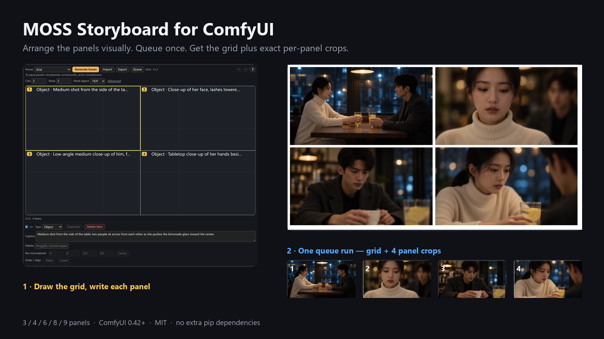

# ComfyUI-MOSS-Storyboard

🌐 **English** · [中文](README_ZH.md)



**Storyboard, local edit and LLM prompt nodes for ComfyUI.** Three uses:

- **Storyboard** — one canvas split into 3 / 4 / 6 / 8 / 9 panels, one caption per panel, exact crops.
- **Local edit** — fix one panel, or put a reference face into one panel, then paste it back. Other panels stay pixel-identical.
- **Prompt** — optional LLM node: caption / expand / edit / assemble. **Not MOSS-only**: also targets Flux, SDXL and Qwen-Image.
  Up to 9 reference images (a new slot appears when the last one is connected); with `target=minimax-h3`, caption and
  expand write the audio-video H3 format directly.

> 🔴 **A box is a hint, not a coordinate.** It becomes one line of text in the prompt; the model decides where to draw.
> It can overshoot, merge boxes, or ignore them. Details: [manual §1](https://github.com/ZenHG/ComfyUI-MOSS-Storyboard/blob/main/docs/19-node-manual.md).

| Item | Value |
|---|---|
| Version | **0.5.1** |
| License | **MIT** (credits: [`THIRD-PARTY-NOTICES.md`](THIRD-PARTY-NOTICES.md)) |
| Host | **ComfyUI ≥ 0.42.0** (native MOSS-Image support) |
| Dependencies | **Zero** extra pip packages for the core nodes. Face Swap's auto mask is **on by default** and needs `insightface` + `onnxruntime` **plus** `det_10g.onnx` (`~/.insightface/models/buffalo_l/`, or `MOSS_INSIGHTFACE_ROOT`). Without them, wire a `mask` manually or turn `auto_mask` off; the node raises a clear error and never downloads weights |

**What this pack guarantees:** canvas size, panel coordinates, crop rectangles, grid-line position — arithmetic, pixel-aligned.
**What it does not guarantee:** what is drawn inside panels, where elements land, or that the same face survives across panels.

---

## 1 · Quick start

### 1.1 Install

| Route | How |
|---|---|
| **Manager** (recommended) | search **MOSS Storyboard** → Install → restart ComfyUI |
| **Registry** | open `https://registry.comfy.org/nodes/moss-storyboard` → Install |
| **Manual** | `cd <ComfyUI>/custom_nodes` → `git clone https://github.com/ZenHG/ComfyUI-MOSS-Storyboard` → restart |

Success looks like this line in the startup log:

```
[MOSS SB] v<version> 已加载｜节点 7 个（出口 v3）｜3/4/6/8/9 宫格
```

No such line = the pack did not load. Do not nest the folder twice
(`custom_nodes/ComfyUI-MOSS-Storyboard/ComfyUI-MOSS-Storyboard/` is one level too deep).

### 1.2 Weights (not bundled)

Download the three files from the official tutorial
<https://docs.comfy.org/tutorials/image/moss-image/moss-image> and put them exactly here, then **restart ComfyUI**:

| File | Folder |
|---|---|
| `moss_image_sft_bf16.safetensors` | `<ComfyUI>/models/diffusion_models/` (older hosts: `models/unet/`) |
| `qwen3.5_9b_int8_convrot.safetensors` | `<ComfyUI>/models/text_encoders/` |
| `flux2-vae.safetensors` | `<ComfyUI>/models/vae/` |

- Optional distilled LoRA: any `*.safetensors` → `<ComfyUI>/models/loras/`. Without it use **50 steps / cfg 3 / euler / sgm_uniform**;
  with a 4-step LoRA use **4 steps / cfg 1.0**.
- **LLM node:** `assemble` needs **no model**, and the `api` channel needs no local weights. For `local`, put GGUF files under
  `<ComfyUI>/models/LLM/` or `<ComfyUI>/models/text_encoders/` (both scanned recursively). `caption` / `edit` need a vision model
  **plus** its `mmproj` in the same folder; `expand` needs a text model only.

### 1.3 First run

- **Fastest check (no weights):** drag [`examples/llm-compile-zero-model.json`](examples/llm-compile-zero-model.json) into ComfyUI and press Run.
  It assembles an IR into a prompt in milliseconds and proves the install.
  For the H3 full-reference six-section manuscript, set `target=minimax-h3` and `profile=six-section`;
  leaving `profile` empty keeps the default three-field skeleton. Both are deterministic and model-free.
- **Let the model expand an idea into H3 format:** pick task `expand` and `target=minimax-h3` to get the
  audio-video three-field timeline; add `profile=six-section` for the full-reference manuscript.
  The dialect list is unchanged on purpose.
- **Multiple reference images (up to 9):** connect one image and a second slot appears; keep connecting to grow.
  With `target=minimax-h3` they are **fused** into one H3 manuscript (one `<Subject N>` per image); with any other
  target each image is captioned **separately** and the output is split by `--- image N ---`.
  Multi-image input is downscaled to fit the token budget; if the context or `max_tokens` is too small, the node
  fails **before loading the weights** and tells you which value to change.
- **First storyboard:** drag [`examples/moss-storyboard-4panels-ui.json`](examples/moss-storyboard-4panels-ui.json), press Run.
  Output goes to `output/moss/storyboard/` (`grid_*.png` + `panel_*.png`).
- **First prompt:** drag [`examples/llm-prompt-workbench.json`](examples/llm-prompt-workbench.json). Only the caption group is on;
  other groups are bypassed (`Ctrl+B` to enable).
- **The LLM panel (0.5.1):** a status card on top says what the node is doing and what is still
  missing; "What" and "Backend" are segmented buttons; the default view shows only four fields.
  Presets are **nested** — open Presets, choose *Connect* (common endpoints: DeepSeek / OpenCode /
  CoRouter / Ollama / LM Studio) or *Sampling* (Draft / Fine / Reset), then pick an entry.
  A separate *Advanced* row opens all parameters and remembers that choice for the session.
  The `api_base` row still has its inline endpoint picker. Changing any value updates the panel
  immediately; no periodic refresh wait.

### 1.4 Where to go next

- All node inputs / outputs: [`docs/19-node-manual.md`](https://github.com/ZenHG/ComfyUI-MOSS-Storyboard/blob/main/docs/19-node-manual.md).
- LLM node details and dialects: [`docs/20-llm-prompt-nodes.md`](https://github.com/ZenHG/ComfyUI-MOSS-Storyboard/blob/main/docs/20-llm-prompt-nodes.md). PE rewriter: [`docs/19-node-manual.md` §9](https://github.com/ZenHG/ComfyUI-MOSS-Storyboard/blob/main/docs/19-node-manual.md); how to run it: §1.6 below.
- More examples: §3.1 below.

### 1.5 What to wire

| Loader | File | Port on Storyboard · Generate |
|---|---|---|
| `UNETLoader` | `moss_image_sft_bf16.safetensors` | `model` |
| `CLIPLoader` | `qwen3.5_9b_int8_convrot.safetensors` (`type=moss_image`) | `clip` |
| `VAELoader` | `flux2-vae.safetensors` | `vae` |

> **Face Swap is different.** Its defaults (`8 steps / cfg 1.0 / simple`) are the 8-step distilled recipe. Chain the 8-step DMD2 LoRA **and** the Moss-Image-Edit LoRA before the model. Wiring a bare `UNETLoader` as above with default steps gives blurry, wrong-identity images; the node does not check for LoRAs. Wiring: `examples/moss-faceswap-ui.json`.

### 1.6 PE rewriter (Qwen-Image 2.1, non-commercial)

The optional LLM Prompt node can hand the prompt to Qwen-Image 2.1's **native** PE system prompt
instead of this pack's prompt. It is off unless the selected GGUF has a matching
`system_prompt.txt` beside it — there is no PE switch, no download, and no change to defaults.

**License first.** PE weights (official `Qwen/Qwen-Image-2.1-PE-T2I` / `-PE-I2I`, and community
GGUFs) are released under `qwen-research`: **non-commercial, internal use only**. This pack is MIT
and ships **no weights and no `system_prompt.txt`**; bring your own and check the upstream license
before any commercial use. Do not commit or redistribute them.

To run PE-I2I (image + edit instruction → precise edit prompt):

1. Put the PE-I2I GGUF, its `mmproj` vision tower, and its native `system_prompt.txt` (must contain
   `ratio_follow` or `rewritten editing instruction`) together in one folder under
   `<ComfyUI>/models/LLM/`. All three are your own files.
2. Drag [`examples/llm-prompt-workbench.json`](examples/llm-prompt-workbench.json) into ComfyUI,
   un-bypass group ④ (Ctrl+B), pick that GGUF in its `model` dropdown, and leave `mmproj` on auto
   (or select the matching tower). Keep the other three groups bypassed.
3. Load your image into `LoadImage`, write the edit instruction in `text`, keep `task=edit`, press Run.
4. The second output `report` prints `PE 改写器模式（编辑）` when PE is active; `dialect`, `length`,
   `must_keep`, `panels` and `style_lock` are bypassed and named in the same report.

PE-T2I (`task=expand`) needs a separate T2I prompt file and weights — the code branch exists but this
pack neither ships nor installs any T2I weights. `caption`, `assemble` and the `api` channel never
enter PE. Reference: [`docs/19-node-manual.md` §9](https://github.com/ZenHG/ComfyUI-MOSS-Storyboard/blob/main/docs/19-node-manual.md).

## 2 · Troubleshooting

### 2.1 A weight is missing from a dropdown

The file is in the wrong folder, or ComfyUI was not restarted. Check the exact paths in §1.2, then restart.

### 2.2 “找不到 llama-server 可执行文件” (LLM node only)

The core storyboard nodes do **not** need it; the startup warning alone is harmless. Pick one route:

1. **One click:** expand the node's **Local engine** group and press **Install / update** on the parameter bar.
   The download and extraction show ComfyUI's own progress. It lands in
   `<custom_nodes>/ComfyUI-MOSS-Storyboard/moss_llm/runtime/`; set `MOSS_LLM_RUNTIME_DIR` to relocate it.
   **Test** next to it runs `--version` only, so you can confirm the binary before loading a model.
2. **Existing binary:** set `runtime` to **custom** and fill `server_exe`, or set `MOSS_LLM_SERVER`.
   With any other `runtime` value `server_exe` is ignored — one setting decides, not two.
3. **Existing OpenAI-compatible service** (LM Studio / Ollama / llama-swap / remote): set `channel` to `api`,
   fill `api_base` (with `/v1`) and `api_model`.

Port is only a starting point: if it is occupied, the node automatically picks the next free port.
Only the same model instance is reused; another model on that port is never borrowed.

**The API key is not saved with the workflow:** it is cleared on save, so a shared graph carries no secret.
Re-enter it after reopening, or set `MOSS_LLM_API_KEY` in the host environment.

### 2.3 VRAM and speed

VAE decode is the peak, not sampling. The figures in the [memory notes](https://github.com/ZenHG/ComfyUI-MOSS-Storyboard/blob/main/docs/06-vae-memory.md) are **formula estimates, not measured peaks of this pack**: on the old host (fused VAE norm not active) a 3120x896 / 8-panel board is estimated at 11.34 GB; the current host takes the fused path and the same board is about 2.84 GB. Do not read either number as “12 GB is enough”.

### 2.4 Known limits

- Boxes are hints; layout adherence is not a quantity we promise. MOSS calls its layout ability *experimental*.
- Identity is not guaranteed across panels. Face Swap is a tool, not a promise.
- The Generate node has no image input; it starts from an empty latent. To edit an existing image, use crop → edit → paste,
  or the Face Swap node (masked img2img).
- 8/9-panel boards give each panel few pixels; small text and fine texture blur first. That is resolution, not a bug.

### 2.5 Error table

Every row maps to one `ValueError` in the source. `%d`/`%s` are shown with example numbers; punctuation and quoting are normalised for the table. `Ctrl+F` a few words from your error.

| Error you see | Cause | Fix |
|---|---|---|
| `提示词有 4 段 [PANEL]，但布局是 8 格` | script lines ≠ panel count | add lines / change panels / set `init=plain` |
| `全局段写「恰好 4 个面板」，但布局是 8 格` | global line disagrees with panel count | change the count or remove the line |
| `逐格模式需要 [PANEL n] 分段描述（现在只有全局描述）。` | per-panel mode with only a global paragraph | add one paragraph per panel |
| `逐格模式要求每格都有一句描述：提示词只有 4 段，布局有 8 格。` | fewer paragraphs than panels | add paragraphs, or use whole-board mode |
| `没接 spec 时必须填 columns 和 rows（都 >0），否则无法确定裁切框` | Crop/Paste without `spec` | wire `spec`, or fill columns × rows |
| `图像 1024x576 不能被 3x2 整除：会得到差 1px 的格子，下游拼接必崩。…` | canvas not divisible | wire `spec`, or use a divisible canvas |
| `index=5 越界：共 4 格（0 起）` | Crop index out of range | use 0…3, or wire Crop's `index` output |
| `index=5 越界：本布局共 4 格（0 起）` | Paste: same, different wording | same; skip `spec` if you edit the whole image |
| `宫格尺寸 1024x1152 与布局 1024x576 不一致` | Paste received a different canvas | feed the image produced with the same `spec` |
| `draft 为空：请粘贴官方 prompt-enhancer 的 caption/layout 草稿 JSON。` | empty compiler input | paste the *draft*, not the compiled result |
| `元素 3 没有描述（caption 不能为空）` | a box has no caption | add a caption, or delete the box |
| `label 只能是 object/character/text（收到 'xxx'）` | invalid state label | use one of the three values |
| `解码尺寸 1024x576 小于布局下限 2048x1152；无法重建裁切几何` | face swap input smaller than the target canvas | feed a larger image, or a smaller `spec` |
| `init=source 需要 image（要换脸的那张图）。` | Face Swap `init=source` without an image | wire the source, or use `init=empty` |

### 2.6 No error but wrong result

| Symptom | Check first |
|---|---|
| all black | mixed recipe bands (50/3 vs 4-step LoRA) |
| right panel count, everything in one panel | boxes are hints; shorten each caption to one shot |
| canvas shape differs from preview | `spec` is wired; `spec` wins |
| can't find the nodes | category `moss/storyboard`; search `storyboard` / `宫格` |
| OOM at VAE decode, or faint seams | tiled decode / lower `panel_edge` |
| no 中 / EN button | hard-refresh (F5); check `[MOSS SB] i18n: 就绪` |

### 2.7 Still stuck

Paste the `[MOSS SB]` startup line, the node `report` (geometry source, measured steps, mask coverage) and your
ComfyUI version. For setup or workflow bugs, open an issue with those three pieces; for security, use the private
channel in [`SECURITY.md`](SECURITY.md).

## 3 · Examples and docs

### 3.1 Examples

Every example is UI format (drag into the canvas). The face-swap examples need your own `moss_faceswap_src.png` and
`moss_faceswap_ref.png`; the single-photo example ships two demo images under `assets/`; group ④ of
`llm-prompt-workbench.json` needs your own PE-I2I GGUF + `mmproj` + `system_prompt.txt` (§1.6, non-commercial);
the rest need nothing.

| File | Job |
|---|---|
| `moss-storyboard-4panels-ui.json` | 4-panel board, plainest wiring |
| `moss-layout-editor-storyboard.json` | 4-panel board with in-graph notes (best starting point) |
| `moss-layout-editor-poster.json` | single poster from the visual editor |
| `moss-prompt-compiler.json` | official draft → prompt + editor state (no model) |
| `moss-faceswap-ui.json` | 4-panel board → swap panel 0 |
| `moss-faceswap-single-ui.json` | one photo → face swap → image out |
| `moss-pose-generate-ui.json` | reference face + prompt → one posed image |
| `moss-storyboard-4panels-edit.json` | crop one panel → edit → paste back |
| `llm-compile-zero-model.json` | IR → prompt via `assemble`, no model (install check) |
| `llm-prompt-workbench.json` | caption / wash / generic expand / PE-I2I, four bypassable groups (PE group needs your own weights) |
| `llm-idea-to-image.json` | one line → single image or 4-panel board |

### 3.2 Docs

- Full parameters, glossary and measured limits: [`docs/19-node-manual.md`](https://github.com/ZenHG/ComfyUI-MOSS-Storyboard/blob/main/docs/19-node-manual.md).
- LLM node (18 parameters, 4 style classes / 16 presets): [`docs/20-llm-prompt-nodes.md`](https://github.com/ZenHG/ComfyUI-MOSS-Storyboard/blob/main/docs/20-llm-prompt-nodes.md). PE rewriter: [`docs/19-node-manual.md` §9](https://github.com/ZenHG/ComfyUI-MOSS-Storyboard/blob/main/docs/19-node-manual.md); how to run it: §1.6 above.
- Docs index: [`docs/README.md`](https://github.com/ZenHG/ComfyUI-MOSS-Storyboard/blob/main/docs/README.md).

> Manuals live in the GitHub repository only; the published package does not ship `docs/`. Links above point to the repository.

### 3.3 Contributing

- Checks, local CI and PR rules: [`CONTRIBUTING.md`](CONTRIBUTING.md).
- Release history: [`CHANGES.md`](CHANGES.md).
- Bug reports: include the `[MOSS SB]` startup line, the node `report`, and your ComfyUI version.

## 4 · License

MIT. Third-party notices and upstream licenses: [`THIRD-PARTY-NOTICES.md`](THIRD-PARTY-NOTICES.md).

> The optional Qwen-Image 2.1 PE weights are **not** covered by this MIT license. They are released under
> `qwen-research` — **non-commercial / internal use only** — and this pack ships neither the weights nor their
> `system_prompt.txt`. Bring your own and check the upstream license before any commercial use (§1.6).
